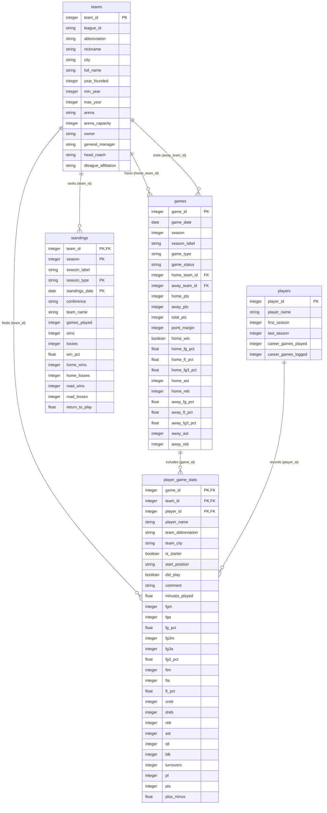

# Arcora Canonical NBA Data Model & Architecture

## 1. Overview

Arcora's canonical NBA data model organizes historical NBA data into five clean, relational entities optimized for both analytical queries and machine learning feature engineering:

1. **`teams`** (`teams.parquet`): Master franchise dimension table (30 NBA teams).
2. **`players`** (`players.parquet`): Unified player dimension table (2,687 NBA players spanning 2003–2022, focused purely on player-level attributes).
3. **`games`** (`games.parquet`): Completed game fact table (26,523 deduplicated games with valid final scores).
4. **`player_game_stats`** (`player_game_stats.parquet`): Player-level game box-score fact table (668,338 deduplicated player-game records, capturing historical team membership per game).
5. **`standings`** (`standings.parquet`): Daily conference standings snapshot table (210,313 deduplicated team-date standings records).

---

## 2. Entity Relationship Diagram (ERD)



---

## 3. Primary Keys & Foreign Key Relationships

| Entity | Primary Key | Foreign Keys | Cardinality |
| :--- | :--- | :--- | :--- |
| `teams` | `(team_id)` | *None* | 1 franchise : N games, standings, box scores |
| `players` | `(player_id)` | *None* | 1 player : N player_game_stats |
| `games` | `(game_id)` | `home_team_id` -> `teams.team_id`, `away_team_id` -> `teams.team_id` | 1 game : N player_game_stats |
| `player_game_stats` | `(game_id, team_id, player_id)` | `game_id` -> `games.game_id`, `team_id` -> `teams.team_id`, `player_id` -> `players.player_id` | N:1 with games, teams, players |
| `standings` | `(team_id, season, season_type, standings_date)` | `team_id` -> `teams.team_id` | N:1 with teams |

---

## 4. Naming Conventions & Type Standards

- **`snake_case` Identifiers**: All table and column names use lowercase `snake_case` (e.g., `GAME_DATE_EST` -> `game_date`, `VISITOR_TEAM_ID` -> `away_team_id`, `PTS_home` -> `home_pts`).
- **SQL Reserved Word Avoidance**: `games_details.TO` (turnovers) is renamed to `turnovers` so SQL queries do not require quoting reserved keywords.
- **Strict Integer & Boolean Typing**: Score, rebound, assist, field-goal, and foul counts that were coerced to `float64` by `NaN` rows in raw CSVs are normalized to `int64`, and win/starter/active flags are stored as native `bool`.
- **Derived Analytical Fields**: `games` precomputes `season_label` (`YYYY-YY`), `game_type` (`Preseason`, `Regular Season`, `Playoffs`, `Play-In`), `total_pts`, and `point_margin` (`home_pts - away_pts`).

---

## 5. Key Assumptions & Design Decisions

1. **Unifying `players` Across `players.csv` and `games_details.csv`**:
   - *Problem*: `players.csv` only contains seasons 2009–2019 (1,769 unique players), leaving 918 players from 2003–2008 and 2020–2022 without a parent record.
   - *Decision*: The canonical `players` entity unions `players.csv` with distinct `(PLAYER_ID, PLAYER_NAME)` entries from `games_details.csv`, enriched with `first_season`, `last_season`, `career_games_played` (`did_play == True`), and `career_games_logged` (all box-score entries). Team membership is intentionally modeled historically in `player_game_stats` rather than a mutable `primary_team_id` on `players`.
2. **Handling Unscored 2003 Preseason Games**:
   - *Problem*: 99 rows in `games.csv` (all in October 2003) have `NaN` for all box-score columns and no rows in `games_details.csv`.
   - *Decision*: Exclude unscored rows from canonical `games.parquet` so all records in `games` have valid, non-null scores and outcomes.
3. **Handling DNP / Inactive Box-Score Rows in `player_game_stats`**:
   - *Problem*: 109,690 rows in `games_details.csv` represent dressed/rostered players who did not enter the game (`MIN` and counting stats are `NaN`).
   - *Decision*: Retain these rows for roster completeness, set `did_play = False`, normalize `minutes_played = 0.0` and counting stats (`pts`, `reb`, `ast`, etc.) to `0`, and preserve the DNP reason in `comment`.
4. **Normalizing `MIN` (Minutes Played)**:
   - *Problem*: Raw `MIN` strings mix `'MM:SS'`, integer strings `'MM'`, float-prefixed strings `'12.000000:00'`, 1,463 `'MM:60'` strings, and 12 corrupted negative strings (e.g., `'-9'`).
   - *Decision*: Parse `'MM:SS'` into decimal minutes (`MM + SS / 60.0`) enforcing `0 <= SS < 60`, reset malformed or negative values to `0.0` (with explicit audit counts in `ingestion_manifest.json`), and store as `float64` in `minutes_played`.
5. **Point-in-Time Leakage Prevention for `standings`**:
   - *Problem*: `standings.parquet` stores daily snapshots (`standings_date`). Joining a game to end-of-season standings or same-day post-game standings would leak future outcomes into pre-game features.
   - *Decision*: `standings` preserves the exact `standings_date` primary-key component so Week 2 feature pipelines can perform an as-of temporal join strictly prior to game day (`standings_date < game_date` within the same `(team_id, season, season_type)`).

---

## 6. Canonical SQL Schema (DDL)

```sql
-- Arcora Canonical NBA Database Schema (DDL)
-- Generated from arcora.models.schema

CREATE TABLE teams (
    team_id BIGINT NOT NULL,
    league_id VARCHAR(4) NOT NULL,
    abbreviation CHAR(3) NOT NULL,
    nickname VARCHAR(64) NOT NULL,
    city VARCHAR(64) NOT NULL,
    full_name VARCHAR(128) NOT NULL,
    year_founded INTEGER NOT NULL,
    min_year INTEGER NOT NULL,
    max_year INTEGER NOT NULL,
    arena VARCHAR(128) NOT NULL,
    arena_capacity INTEGER NULL,
    owner VARCHAR(128) NOT NULL,
    general_manager VARCHAR(128) NOT NULL,
    head_coach VARCHAR(128) NOT NULL,
    dleague_affiliation VARCHAR(128) NOT NULL,
    CONSTRAINT pk_teams PRIMARY KEY (team_id)
);

CREATE TABLE players (
    player_id BIGINT NOT NULL,
    player_name VARCHAR(128) NOT NULL,
    first_season INTEGER NOT NULL,
    last_season INTEGER NOT NULL,
    career_games_played INTEGER NOT NULL,
    career_games_logged INTEGER NOT NULL,
    CONSTRAINT pk_players PRIMARY KEY (player_id)
);

CREATE TABLE games (
    game_id BIGINT NOT NULL,
    game_date DATE NOT NULL,
    season INTEGER NOT NULL,
    season_label CHAR(7) NOT NULL,
    game_type VARCHAR(32) NOT NULL,
    game_status VARCHAR(32) NOT NULL,
    home_team_id BIGINT NOT NULL,
    away_team_id BIGINT NOT NULL,
    home_pts INTEGER NOT NULL,
    away_pts INTEGER NOT NULL,
    total_pts INTEGER NOT NULL,
    point_margin INTEGER NOT NULL,
    home_win BOOLEAN NOT NULL,
    home_fg_pct DOUBLE PRECISION NOT NULL,
    home_ft_pct DOUBLE PRECISION NOT NULL,
    home_fg3_pct DOUBLE PRECISION NOT NULL,
    home_ast INTEGER NOT NULL,
    home_reb INTEGER NOT NULL,
    away_fg_pct DOUBLE PRECISION NOT NULL,
    away_ft_pct DOUBLE PRECISION NOT NULL,
    away_fg3_pct DOUBLE PRECISION NOT NULL,
    away_ast INTEGER NOT NULL,
    away_reb INTEGER NOT NULL,
    CONSTRAINT pk_games PRIMARY KEY (game_id),
    CONSTRAINT fk_games_home_team_id FOREIGN KEY (home_team_id) REFERENCES teams (team_id),
    CONSTRAINT fk_games_away_team_id FOREIGN KEY (away_team_id) REFERENCES teams (team_id)
);

CREATE TABLE player_game_stats (
    game_id BIGINT NOT NULL,
    team_id BIGINT NOT NULL,
    player_id BIGINT NOT NULL,
    player_name VARCHAR(128) NOT NULL,
    team_abbreviation CHAR(3) NOT NULL,
    team_city VARCHAR(64) NOT NULL,
    is_starter BOOLEAN NOT NULL,
    start_position CHAR(1) NULL,
    did_play BOOLEAN NOT NULL,
    comment VARCHAR(256) NULL,
    minutes_played DOUBLE PRECISION NOT NULL,
    fgm INTEGER NOT NULL,
    fga INTEGER NOT NULL,
    fg_pct DOUBLE PRECISION NOT NULL,
    fg3m INTEGER NOT NULL,
    fg3a INTEGER NOT NULL,
    fg3_pct DOUBLE PRECISION NOT NULL,
    ftm INTEGER NOT NULL,
    fta INTEGER NOT NULL,
    ft_pct DOUBLE PRECISION NOT NULL,
    oreb INTEGER NOT NULL,
    dreb INTEGER NOT NULL,
    reb INTEGER NOT NULL,
    ast INTEGER NOT NULL,
    stl INTEGER NOT NULL,
    blk INTEGER NOT NULL,
    turnovers INTEGER NOT NULL,
    pf INTEGER NOT NULL,
    pts INTEGER NOT NULL,
    plus_minus DOUBLE PRECISION NULL,
    CONSTRAINT pk_player_game_stats PRIMARY KEY (game_id, team_id, player_id),
    CONSTRAINT fk_player_game_stats_game_id FOREIGN KEY (game_id) REFERENCES games (game_id),
    CONSTRAINT fk_player_game_stats_team_id FOREIGN KEY (team_id) REFERENCES teams (team_id),
    CONSTRAINT fk_player_game_stats_player_id FOREIGN KEY (player_id) REFERENCES players (player_id)
);

CREATE TABLE standings (
    team_id BIGINT NOT NULL,
    season INTEGER NOT NULL,
    season_label CHAR(7) NOT NULL,
    season_type VARCHAR(32) NOT NULL,
    standings_date DATE NOT NULL,
    conference VARCHAR(16) NOT NULL,
    team_name VARCHAR(64) NOT NULL,
    games_played INTEGER NOT NULL,
    wins INTEGER NOT NULL,
    losses INTEGER NOT NULL,
    win_pct DOUBLE PRECISION NOT NULL,
    home_wins INTEGER NOT NULL,
    home_losses INTEGER NOT NULL,
    road_wins INTEGER NOT NULL,
    road_losses INTEGER NOT NULL,
    return_to_play DOUBLE PRECISION NULL,
    CONSTRAINT pk_standings PRIMARY KEY (team_id, season, season_type, standings_date),
    CONSTRAINT fk_standings_team_id FOREIGN KEY (team_id) REFERENCES teams (team_id)
);
```
