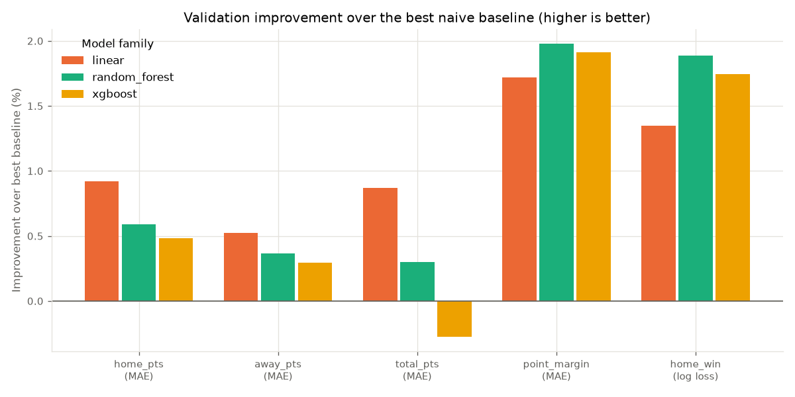
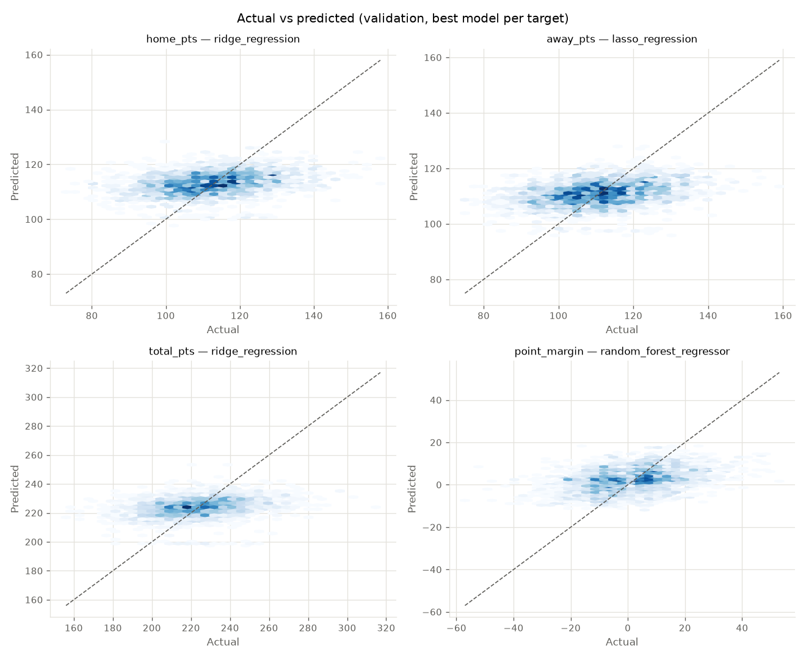
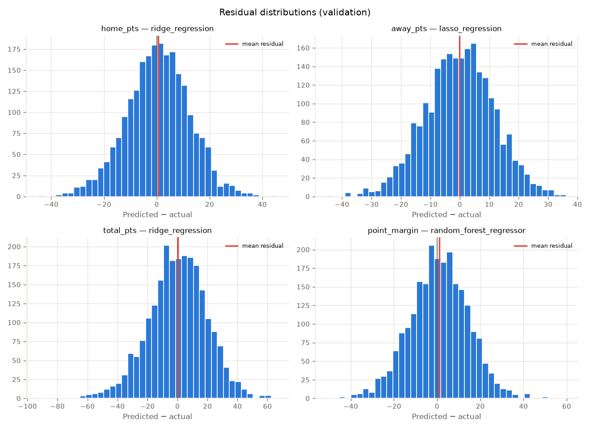
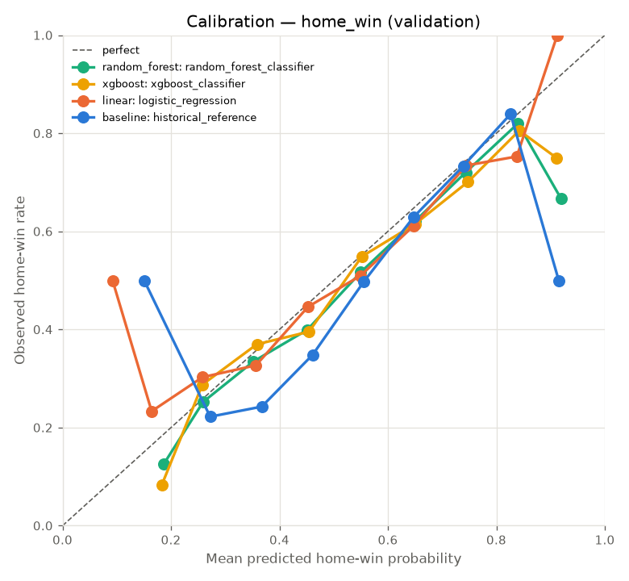
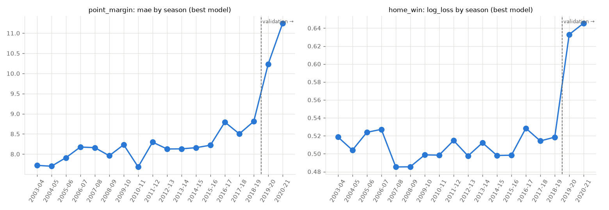

# Arcora Week 3 — Model Evaluation and Comparison

All models are compared on the **validation** split (2019-20 to 2020-21) with the shared metric implementation in `src/arcora/evaluation/metrics.py`. Every result carries the same dataset, split, and feature fingerprints (verified before comparison). The locked 2021-22 test set and partial 2022-23 holdout are not analyzed here.

## Best model per target

| Target | Metric | Best model | Family | Score | Best baseline | Improvement |
| :--- | :--- | :--- | :--- | ---: | ---: | ---: |
| `home_pts` | mae | `ridge_regression` | linear | 9.4469 | 9.5347 | 0.92% |
| `away_pts` | mae | `lasso_regression` | linear | 9.3794 | 9.4288 | 0.52% |
| `total_pts` | mae | `ridge_regression` | linear | 15.2369 | 15.3710 | 0.87% |
| `point_margin` | mae | `random_forest_regressor` | random_forest | 10.7479 | 10.9651 | 1.98% |
| `home_win` | log_loss | `random_forest_classifier` | random_forest | 0.6393 | 0.6516 | 1.89% |

## Paired bootstrap: best model vs best naive baseline

Mean per-game loss difference (best model − baseline; negative = better), with a 95% bootstrap interval over validation games.

| Target | Metric | Best model | Baseline | Δ loss | 95% CI | Significant |
| :--- | :--- | :--- | :--- | ---: | :--- | :---: |
| `home_pts` | mae | `ridge_regression__home_pts` | `historical_reference__home_pts` | -0.0878 | [-0.1514, -0.0208] | Yes |
| `away_pts` | mae | `lasso_regression__away_pts` | `historical_reference__away_pts` | -0.0494 | [-0.1280, +0.0250] | No |
| `total_pts` | mae | `ridge_regression__total_pts` | `historical_reference__total_pts` | -0.1341 | [-0.2462, -0.0213] | Yes |
| `point_margin` | mae | `random_forest_regressor__point_margin` | `historical_reference__point_margin` | -0.2172 | [-0.3166, -0.1158] | Yes |
| `home_win` | log_loss | `random_forest_classifier__home_win` | `historical_reference__home_win` | -0.0123 | [-0.0187, -0.0057] | Yes |

## Regression comparison (validation)

| target | rank | model_name | model_family | mae | rmse | r2 | improvement_pct |
| :--- | ---: | :--- | :--- | ---: | ---: | ---: | ---: |
| home_pts | 1 | ridge_regression | linear | 9.447 | 11.965 | 0.092 | 0.921 |
| home_pts | 2 | lasso_regression | linear | 9.459 | 11.980 | 0.090 | 0.792 |
| home_pts | 3 | linear_regression | linear | 9.470 | 11.995 | 0.088 | 0.681 |
| home_pts | 4 | random_forest_regressor | random_forest | 9.478 | 12.010 | 0.085 | 0.593 |
| home_pts | 5 | xgboost_regressor | xgboost | 9.489 | 12.016 | 0.084 | 0.481 |
| home_pts | 6 | historical_reference | baseline | 9.535 | 12.067 | 0.077 | 0.000 |
| home_pts | 7 | median_baseline | baseline | 13.232 | 16.443 | -0.714 | -38.778 |
| home_pts | 8 | mean_baseline | baseline | 13.298 | 16.510 | -0.729 | -39.468 |
| away_pts | 1 | lasso_regression | linear | 9.379 | 11.744 | 0.101 | 0.523 |
| away_pts | 2 | ridge_regression | linear | 9.383 | 11.756 | 0.099 | 0.481 |
| away_pts | 3 | random_forest_regressor | random_forest | 9.394 | 11.814 | 0.090 | 0.366 |
| away_pts | 4 | xgboost_regressor | xgboost | 9.401 | 11.842 | 0.086 | 0.294 |
| away_pts | 5 | historical_reference | baseline | 9.429 | 11.887 | 0.079 | 0.000 |
| away_pts | 6 | linear_regression | linear | 9.446 | 11.844 | 0.086 | -0.183 |
| away_pts | 7 | mean_baseline | baseline | 14.238 | 17.372 | -0.967 | -51.003 |
| away_pts | 8 | median_baseline | baseline | 14.809 | 17.961 | -1.103 | -57.066 |
| total_pts | 1 | ridge_regression | linear | 15.237 | 19.342 | 0.082 | 0.872 |
| total_pts | 2 | lasso_regression | linear | 15.281 | 19.387 | 0.078 | 0.588 |
| total_pts | 3 | random_forest_regressor | random_forest | 15.325 | 19.475 | 0.070 | 0.299 |
| total_pts | 4 | historical_reference | baseline | 15.371 | 19.512 | 0.066 | 0.000 |
| total_pts | 5 | xgboost_regressor | xgboost | 15.413 | 19.565 | 0.061 | -0.272 |
| total_pts | 6 | linear_regression | linear | 15.434 | 19.519 | 0.065 | -0.411 |
| total_pts | 7 | mean_baseline | baseline | 25.213 | 30.530 | -1.286 | -64.032 |
| total_pts | 8 | median_baseline | baseline | 25.756 | 31.074 | -1.369 | -67.564 |
| point_margin | 1 | random_forest_regressor | random_forest | 10.748 | 13.631 | 0.134 | 1.981 |
| point_margin | 2 | xgboost_regressor | xgboost | 10.755 | 13.649 | 0.132 | 1.915 |
| point_margin | 3 | lasso_regression | linear | 10.777 | 13.670 | 0.129 | 1.719 |
| point_margin | 4 | ridge_regression | linear | 10.818 | 13.681 | 0.128 | 1.341 |
| point_margin | 5 | linear_regression | linear | 10.837 | 13.686 | 0.127 | 1.173 |
| point_margin | 6 | historical_reference | baseline | 10.965 | 13.898 | 0.100 | 0.000 |
| point_margin | 7 | mean_baseline | baseline | 11.679 | 14.720 | -0.010 | -6.511 |
| point_margin | 8 | median_baseline | baseline | 11.732 | 14.841 | -0.027 | -6.995 |

## Classification comparison — `home_win` (validation)

| rank | model_name | model_family | accuracy | balanced_accuracy | precision | recall | roc_auc | log_loss | brier |
| ---: | :--- | :--- | ---: | ---: | ---: | ---: | ---: | ---: | ---: |
| 1 | random_forest_classifier | random_forest | 0.634 | 0.616 | 0.629 | 0.806 | 0.682 | 0.639 | 0.224 |
| 2 | xgboost_classifier | xgboost | 0.640 | 0.626 | 0.641 | 0.776 | 0.682 | 0.640 | 0.224 |
| 3 | logistic_regression | linear | 0.628 | 0.614 | 0.631 | 0.772 | 0.679 | 0.643 | 0.226 |
| 4 | historical_reference | baseline | 0.618 | 0.590 | 0.602 | 0.883 | 0.674 | 0.652 | 0.230 |
| 5 | prior_baseline | baseline | 0.547 | 0.500 | 0.547 | 1.000 | 0.500 | 0.694 | 0.250 |
| 6 | most_frequent_baseline | baseline | 0.547 | 0.500 | 0.547 | 1.000 | 0.500 | 15.658 | 0.453 |

## Best model per family

| target | model_family | model_name | primary_metric | primary_score | rank |
| :--- | :--- | :--- | :--- | ---: | ---: |
| away_pts | linear | lasso_regression | mae | 9.3794 | 1 |
| away_pts | random_forest | random_forest_regressor | mae | 9.3942 | 3 |
| away_pts | xgboost | xgboost_regressor | mae | 9.4011 | 4 |
| away_pts | baseline | historical_reference | mae | 9.4288 | 5 |
| home_pts | linear | ridge_regression | mae | 9.4469 | 1 |
| home_pts | random_forest | random_forest_regressor | mae | 9.4782 | 4 |
| home_pts | xgboost | xgboost_regressor | mae | 9.4889 | 5 |
| home_pts | baseline | historical_reference | mae | 9.5347 | 6 |
| home_win | random_forest | random_forest_classifier | log_loss | 0.6393 | 1 |
| home_win | xgboost | xgboost_classifier | log_loss | 0.6402 | 2 |
| home_win | linear | logistic_regression | log_loss | 0.6428 | 3 |
| home_win | baseline | historical_reference | log_loss | 0.6516 | 4 |
| point_margin | random_forest | random_forest_regressor | mae | 10.7479 | 1 |
| point_margin | xgboost | xgboost_regressor | mae | 10.7550 | 2 |
| point_margin | linear | lasso_regression | mae | 10.7766 | 3 |
| point_margin | baseline | historical_reference | mae | 10.9651 | 6 |
| total_pts | linear | ridge_regression | mae | 15.2369 | 1 |
| total_pts | random_forest | random_forest_regressor | mae | 15.3250 | 3 |
| total_pts | baseline | historical_reference | mae | 15.3710 | 4 |
| total_pts | xgboost | xgboost_regressor | mae | 15.4129 | 5 |

## Error analysis — regression (validation)

### `home_pts` — `ridge_regression__home_pts`

- Mean residual (bias): **+0.54**, residual std 11.96; 90% of residuals in [-19.7, +19.7].
- Within ±5 points: 33.7%; within ±10: 61.1%.

By season:

| season_label | n_games | mae | rmse | bias |
| :--- | ---: | ---: | ---: | ---: |
| 2019-20 | 1143 | 9.299 | 11.915 | 0.387 |
| 2020-21 | 1171 | 9.591 | 12.014 | 0.680 |

By game type:

| game_type | n_games | mae | rmse | bias |
| :--- | ---: | ---: | ---: | ---: |
| Play-In | 7 | 12.443 | 15.437 | -4.037 |
| Playoffs | 168 | 9.746 | 12.289 | 2.070 |
| Regular Season | 2139 | 9.414 | 11.926 | 0.430 |

Home teams with the highest / lowest MAE:

| home_team | n_games | mae | bias |
| :--- | ---: | ---: | ---: |
| LAC | 89 | 11.207 | -1.083 |
| WAS | 75 | 10.840 | -1.742 |
| NYK | 72 | 10.720 | 2.587 |
| MIA | 84 | 8.203 | 0.727 |
| CHA | 67 | 8.185 | 3.992 |
| UTA | 80 | 7.537 | -0.698 |

Away teams with the highest / lowest MAE:

| away_team | n_games | mae | bias |
| :--- | ---: | ---: | ---: |
| NYK | 71 | 11.291 | 2.846 |
| MIN | 68 | 10.730 | -2.828 |
| ATL | 79 | 10.616 | -2.663 |
| DET | 69 | 8.171 | 1.076 |
| LAL | 84 | 8.149 | 3.868 |
| ORL | 77 | 6.926 | 1.617 |

Largest errors:

| game_date | game_type | home_team | away_team | y_true | y_pred | residual |
| :--- | :--- | :--- | :--- | ---: | ---: | ---: |
| 2020-12-27 00:00:00 | Regular Season | LAC | DAL | 73.0 | 118.5 | 45.5 |
| 2019-10-30 00:00:00 | Regular Season | WAS | HOU | 158.0 | 113.0 | -45.0 |
| 2021-01-20 00:00:00 | Regular Season | CLE | BKN | 147.0 | 107.1 | -39.9 |
| 2021-01-17 00:00:00 | Regular Season | BOS | NYK | 75.0 | 113.0 | 38.0 |
| 2019-12-13 00:00:00 | Regular Season | CHI | CHA | 73.0 | 110.3 | 37.3 |

### `away_pts` — `lasso_regression__away_pts`

- Mean residual (bias): **-0.05**, residual std 11.75; 90% of residuals in [-19.7, +18.9].
- Within ±5 points: 32.8%; within ±10: 61.4%.

By season:

| season_label | n_games | mae | rmse | bias |
| :--- | ---: | ---: | ---: | ---: |
| 2019-20 | 1143 | 9.220 | 11.454 | 0.175 |
| 2020-21 | 1171 | 9.535 | 12.020 | -0.276 |

By game type:

| game_type | n_games | mae | rmse | bias |
| :--- | ---: | ---: | ---: | ---: |
| Play-In | 7 | 8.903 | 9.970 | 4.380 |
| Playoffs | 168 | 9.504 | 12.025 | -0.029 |
| Regular Season | 2139 | 9.371 | 11.727 | -0.069 |

Home teams with the highest / lowest MAE:

| home_team | n_games | mae | bias |
| :--- | ---: | ---: | ---: |
| MEM | 76 | 10.882 | 1.703 |
| SAS | 70 | 10.440 | -1.868 |
| DAL | 80 | 10.298 | -1.824 |
| CHI | 70 | 7.935 | 1.734 |
| PHI | 80 | 7.928 | 1.404 |
| CHA | 67 | 7.725 | 1.514 |

Away teams with the highest / lowest MAE:

| away_team | n_games | mae | bias |
| :--- | ---: | ---: | ---: |
| HOU | 78 | 11.174 | -0.593 |
| WAS | 76 | 10.458 | -1.593 |
| MEM | 77 | 10.325 | -3.624 |
| CHI | 67 | 8.220 | -0.097 |
| SAC | 73 | 7.864 | -0.589 |
| BOS | 84 | 7.764 | 0.061 |

Largest errors:

| game_date | game_type | home_team | away_team | y_true | y_pred | residual |
| :--- | :--- | :--- | :--- | ---: | ---: | ---: |
| 2019-10-30 00:00:00 | Regular Season | WAS | HOU | 159.0 | 113.9 | -45.1 |
| 2020-07-31 00:00:00 | Regular Season | DAL | HOU | 153.0 | 114.6 | -38.4 |
| 2020-08-23 00:00:00 | Playoffs | BKN | TOR | 150.0 | 112.2 | -37.8 |
| 2021-04-28 00:00:00 | Regular Season | SAC | UTA | 154.0 | 116.3 | -37.7 |
| 2019-10-24 00:00:00 | Regular Season | GSW | LAC | 141.0 | 103.3 | -37.7 |

### `total_pts` — `ridge_regression__total_pts`

- Mean residual (bias): **+0.24**, residual std 19.34; 90% of residuals in [-32.2, +30.4].
- Within ±5 points: 20.2%; within ±10: 40.6%.

By season:

| season_label | n_games | mae | rmse | bias |
| :--- | ---: | ---: | ---: | ---: |
| 2019-20 | 1143 | 15.317 | 19.418 | 0.226 |
| 2020-21 | 1171 | 15.158 | 19.269 | 0.249 |

By game type:

| game_type | n_games | mae | rmse | bias |
| :--- | ---: | ---: | ---: | ---: |
| Play-In | 7 | 19.438 | 21.525 | -0.099 |
| Playoffs | 168 | 15.418 | 20.058 | 2.612 |
| Regular Season | 2139 | 15.209 | 19.277 | 0.052 |

Home teams with the highest / lowest MAE:

| home_team | n_games | mae | bias |
| :--- | ---: | ---: | ---: |
| ATL | 78 | 17.463 | -1.776 |
| WAS | 75 | 17.353 | -3.807 |
| BOS | 83 | 17.310 | -2.384 |
| PHI | 80 | 13.387 | -0.044 |
| UTA | 80 | 13.101 | 0.329 |
| CLE | 72 | 12.902 | -1.547 |

Away teams with the highest / lowest MAE:

| away_team | n_games | mae | bias |
| :--- | ---: | ---: | ---: |
| WAS | 76 | 17.075 | -5.918 |
| NYK | 71 | 17.060 | 4.393 |
| TOR | 77 | 16.989 | 1.493 |
| PHX | 81 | 13.354 | 0.824 |
| BOS | 84 | 13.303 | 3.166 |
| ORL | 77 | 12.952 | 3.400 |

Largest errors:

| game_date | game_type | home_team | away_team | y_true | y_pred | residual |
| :--- | :--- | :--- | :--- | ---: | ---: | ---: |
| 2019-10-30 00:00:00 | Regular Season | WAS | HOU | 317.0 | 224.1 | -92.9 |
| 2020-07-31 00:00:00 | Regular Season | DAL | HOU | 302.0 | 231.2 | -70.8 |
| 2020-09-01 00:00:00 | Playoffs | DEN | UTA | 158.0 | 224.4 | 66.4 |
| 2021-01-20 00:00:00 | Regular Season | CLE | BKN | 282.0 | 217.1 | -64.9 |
| 2021-04-26 00:00:00 | Regular Season | WAS | SAS | 289.0 | 225.4 | -63.6 |

### `point_margin` — `random_forest_regressor__point_margin`

- Mean residual (bias): **+0.93**, residual std 13.60; 90% of residuals in [-21.4, +22.6].
- Within ±5 points: 29.6%; within ±10: 54.8%.

By season:

| season_label | n_games | mae | rmse | bias |
| :--- | ---: | ---: | ---: | ---: |
| 2019-20 | 1143 | 10.236 | 13.007 | 0.563 |
| 2020-21 | 1171 | 11.248 | 14.215 | 1.297 |

By game type:

| game_type | n_games | mae | rmse | bias |
| :--- | ---: | ---: | ---: | ---: |
| Play-In | 7 | 10.988 | 14.615 | -8.400 |
| Playoffs | 168 | 11.106 | 13.428 | 1.232 |
| Regular Season | 2139 | 10.719 | 13.644 | 0.941 |

Home teams with the highest / lowest MAE:

| home_team | n_games | mae | bias |
| :--- | ---: | ---: | ---: |
| HOU | 78 | 12.633 | 1.823 |
| LAC | 89 | 12.520 | -0.609 |
| DET | 69 | 11.908 | 2.376 |
| POR | 78 | 9.146 | 0.735 |
| PHI | 80 | 8.962 | -1.994 |
| CHA | 67 | 8.825 | 2.305 |

Away teams with the highest / lowest MAE:

| away_team | n_games | mae | bias |
| :--- | ---: | ---: | ---: |
| MEM | 77 | 12.910 | 3.206 |
| GSW | 68 | 12.881 | -1.006 |
| DAL | 80 | 12.586 | 3.892 |
| TOR | 77 | 9.161 | 2.151 |
| CHI | 67 | 8.767 | 1.320 |
| DET | 69 | 8.752 | -0.398 |

Largest errors:

| game_date | game_type | home_team | away_team | y_true | y_pred | residual |
| :--- | :--- | :--- | :--- | ---: | ---: | ---: |
| 2020-12-27 00:00:00 | Regular Season | LAC | DAL | -51.0 | 8.7 | 59.7 |
| 2021-04-02 00:00:00 | Regular Season | TOR | GSW | 53.0 | 2.1 | -50.9 |
| 2021-05-01 00:00:00 | Regular Season | OKC | IND | -57.0 | -7.2 | 49.8 |
| 2020-12-29 00:00:00 | Regular Season | MIA | MIL | -47.0 | 2.0 | 49.0 |
| 2021-02-28 00:00:00 | Regular Season | HOU | MEM | -49.0 | -2.3 | 46.7 |

## Error analysis — classification (`random_forest_classifier__home_win`, validation)

| | Predicted home win | Predicted away win |
| :--- | ---: | ---: |
| **Actual home win** | 1019 (TP) | 246 (FN) |
| **Actual away win** | 601 (FP) | 448 (TN) |

False positives (predicted home win, away team won): **601**; false negatives: **246**. The model leans toward predicting home wins (more false positives than false negatives); compare the observed and predicted home-win rates by season below.

By season:

| season_label | n_games | home_win_rate | mean_predicted_prob | accuracy | log_loss | brier |
| :--- | ---: | ---: | ---: | ---: | ---: | ---: |
| 2019-20 | 1143 | 0.547 | 0.578 | 0.647 | 0.633 | 0.221 |
| 2020-21 | 1171 | 0.547 | 0.577 | 0.622 | 0.646 | 0.227 |

By game type:

| game_type | n_games | home_win_rate | mean_predicted_prob | accuracy | log_loss |
| :--- | ---: | ---: | ---: | ---: | ---: |
| Play-In | 7 | 0.857 | 0.623 | 0.714 | 0.562 |
| Playoffs | 168 | 0.524 | 0.607 | 0.601 | 0.666 |
| Regular Season | 2139 | 0.547 | 0.575 | 0.636 | 0.637 |

Most confident false positives:

| game_date | game_type | home_team | away_team | y_pred |
| :--- | :--- | :--- | :--- | ---: |
| 2020-02-28 00:00:00 | Regular Season | TOR | CHA | 0.912 |
| 2020-03-03 00:00:00 | Regular Season | DEN | GSW | 0.909 |
| 2020-02-01 00:00:00 | Regular Season | IND | NYK | 0.892 |
| 2021-03-30 00:00:00 | Regular Season | LAC | ORL | 0.884 |
| 2020-03-11 00:00:00 | Regular Season | MIA | CHA | 0.873 |

## Error by season across development splits

Per-season error of the best model over training and validation seasons. Training seasons are in-sample, so their error is optimistic; the jump at the validation boundary reflects both out-of-sample error and the 2019-21 scoring and home-advantage shift (shortened 2019-20 season, bubble playoffs, limited crowds in 2020-21).

## Reproducibility and rules

- One metric implementation for every model (`compute_metrics`); undefined metrics are stored as `null` and listed per result.
- `validate_comparability()` refuses to compare results scored on different datasets, splits, or feature lists.
- Error analysis is restricted to development splits; locked splits raise `PermissionError` unless explicitly allowed for a documented final evaluation.
- Generated: 2026-11-24T09:31:53+00:00.
