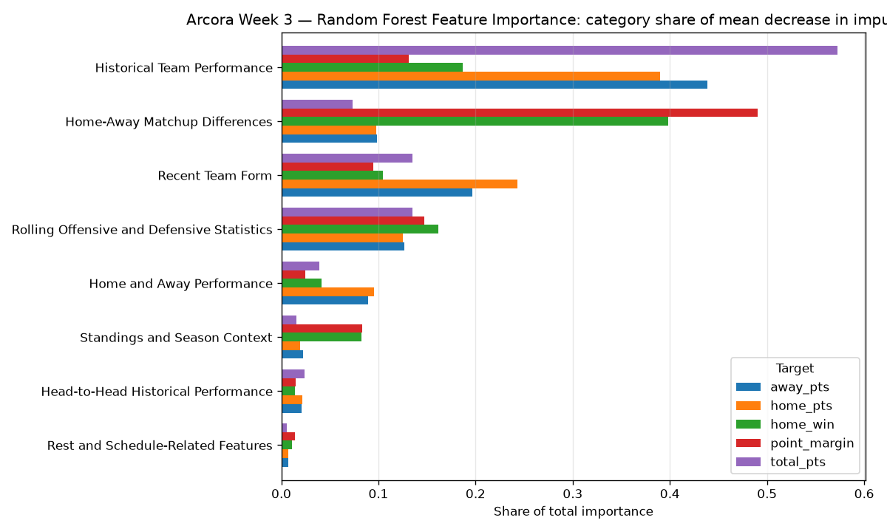

# Arcora Week 3 — Random Forest Feature Importance

> **Exploratory analysis.** Importance shows what the fitted models rely on; it is not evidence of causation. Many features are strongly correlated (home, away, and difference variants), so importance is shared across related columns.

- **Mean decrease in impurity (MDI)** is computed from the training fit and normalized to sum to 1 per model.
- **Grouped permutation importance** permutes every feature in a category together on the validation split and reports the mean increase in the primary metric (MAE for regression, log loss for classification) over repeated shuffles.

## Category share of native importance

| Category | `away_pts` | `home_pts` | `home_win` | `point_margin` | `total_pts` |
| :--- | ---: | ---: | ---: | ---: | ---: |
| Historical Team Performance | 0.438 | 0.390 | 0.187 | 0.131 | 0.573 |
| Home-Away Matchup Differences | 0.099 | 0.098 | 0.398 | 0.490 | 0.073 |
| Recent Team Form | 0.196 | 0.243 | 0.104 | 0.095 | 0.135 |
| Rolling Offensive and Defensive Statistics | 0.127 | 0.125 | 0.162 | 0.147 | 0.135 |
| Home and Away Performance | 0.089 | 0.096 | 0.042 | 0.025 | 0.039 |
| Standings and Season Context | 0.022 | 0.020 | 0.082 | 0.084 | 0.015 |
| Head-to-Head Historical Performance | 0.021 | 0.021 | 0.014 | 0.015 | 0.024 |
| Rest and Schedule-Related Features | 0.007 | 0.007 | 0.011 | 0.014 | 0.006 |

## Grouped permutation importance (validation)

| Model | Category | Features | Metric | Mean increase | Std |
| :--- | :--- | ---: | :--- | ---: | ---: |
| `random_forest_regressor__home_pts` | Historical Team Performance | 48 | mae | +0.1208 | 0.0231 |
| `random_forest_regressor__home_pts` | Recent Team Form | 40 | mae | +0.1127 | 0.0339 |
| `random_forest_regressor__home_pts` | Home-Away Matchup Differences | 50 | mae | +0.0801 | 0.0209 |
| `random_forest_regressor__home_pts` | Home and Away Performance | 10 | mae | +0.0440 | 0.0203 |
| `random_forest_regressor__home_pts` | Rolling Offensive and Defensive Statistics | 56 | mae | +0.0212 | 0.0088 |
| `random_forest_regressor__home_pts` | Standings and Season Context | 14 | mae | +0.0199 | 0.0092 |
| `random_forest_regressor__home_pts` | Rest and Schedule-Related Features | 20 | mae | -0.0003 | 0.0004 |
| `random_forest_regressor__home_pts` | Head-to-Head Historical Performance | 4 | mae | -0.0090 | 0.0059 |
| `random_forest_regressor__away_pts` | Historical Team Performance | 48 | mae | +0.1747 | 0.0509 |
| `random_forest_regressor__away_pts` | Recent Team Form | 40 | mae | +0.1637 | 0.0588 |
| `random_forest_regressor__away_pts` | Home-Away Matchup Differences | 50 | mae | +0.0562 | 0.0101 |
| `random_forest_regressor__away_pts` | Standings and Season Context | 14 | mae | +0.0306 | 0.0050 |
| `random_forest_regressor__away_pts` | Rolling Offensive and Defensive Statistics | 56 | mae | +0.0213 | 0.0158 |
| `random_forest_regressor__away_pts` | Home and Away Performance | 10 | mae | +0.0108 | 0.0067 |
| `random_forest_regressor__away_pts` | Rest and Schedule-Related Features | 20 | mae | +0.0001 | 0.0012 |
| `random_forest_regressor__away_pts` | Head-to-Head Historical Performance | 4 | mae | -0.0079 | 0.0050 |
| `random_forest_regressor__total_pts` | Historical Team Performance | 48 | mae | +0.3411 | 0.0671 |
| `random_forest_regressor__total_pts` | Recent Team Form | 40 | mae | +0.2182 | 0.0471 |
| `random_forest_regressor__total_pts` | Rolling Offensive and Defensive Statistics | 56 | mae | +0.0813 | 0.0222 |
| `random_forest_regressor__total_pts` | Home and Away Performance | 10 | mae | +0.0331 | 0.0127 |
| `random_forest_regressor__total_pts` | Standings and Season Context | 14 | mae | +0.0241 | 0.0055 |
| `random_forest_regressor__total_pts` | Rest and Schedule-Related Features | 20 | mae | +0.0013 | 0.0020 |
| `random_forest_regressor__total_pts` | Home-Away Matchup Differences | 50 | mae | -0.0013 | 0.0096 |
| `random_forest_regressor__total_pts` | Head-to-Head Historical Performance | 4 | mae | -0.0013 | 0.0121 |
| `random_forest_regressor__point_margin` | Home-Away Matchup Differences | 50 | mae | +1.1322 | 0.0832 |
| `random_forest_regressor__point_margin` | Standings and Season Context | 14 | mae | +0.0349 | 0.0034 |
| `random_forest_regressor__point_margin` | Rolling Offensive and Defensive Statistics | 56 | mae | +0.0167 | 0.0041 |
| `random_forest_regressor__point_margin` | Historical Team Performance | 48 | mae | +0.0116 | 0.0110 |
| `random_forest_regressor__point_margin` | Recent Team Form | 40 | mae | +0.0112 | 0.0045 |
| `random_forest_regressor__point_margin` | Rest and Schedule-Related Features | 20 | mae | +0.0080 | 0.0020 |
| `random_forest_regressor__point_margin` | Home and Away Performance | 10 | mae | +0.0069 | 0.0050 |
| `random_forest_regressor__point_margin` | Head-to-Head Historical Performance | 4 | mae | +0.0037 | 0.0021 |
| `random_forest_classifier__home_win` | Home-Away Matchup Differences | 50 | log_loss | +0.0343 | 0.0027 |
| `random_forest_classifier__home_win` | Standings and Season Context | 14 | log_loss | +0.0026 | 0.0003 |
| `random_forest_classifier__home_win` | Historical Team Performance | 48 | log_loss | +0.0025 | 0.0016 |
| `random_forest_classifier__home_win` | Rolling Offensive and Defensive Statistics | 56 | log_loss | +0.0011 | 0.0007 |
| `random_forest_classifier__home_win` | Home and Away Performance | 10 | log_loss | +0.0004 | 0.0004 |
| `random_forest_classifier__home_win` | Rest and Schedule-Related Features | 20 | log_loss | +0.0003 | 0.0001 |
| `random_forest_classifier__home_win` | Recent Team Form | 40 | log_loss | +0.0002 | 0.0005 |
| `random_forest_classifier__home_win` | Head-to-Head Historical Performance | 4 | log_loss | +0.0001 | 0.0001 |

## Top 15 features — `random_forest_regressor__point_margin`

| Rank | Feature | Category | Importance |
| ---: | :--- | :--- | ---: |
| 1 | `hist_margin_avg_diff` | Home-Away Matchup Differences | 0.1340 |
| 2 | `hist_net_rtg_diff` | Home-Away Matchup Differences | 0.0968 |
| 3 | `hist_win_pct_diff` | Home-Away Matchup Differences | 0.0589 |
| 4 | `standings_win_pct_diff` | Standings and Season Context | 0.0536 |
| 5 | `venue_margin_avg_diff` | Home-Away Matchup Differences | 0.0429 |
| 6 | `venue_win_pct_diff` | Home-Away Matchup Differences | 0.0136 |
| 7 | `rolling_margin_avg_10_diff` | Home-Away Matchup Differences | 0.0134 |
| 8 | `rolling_net_rtg_10_diff` | Home-Away Matchup Differences | 0.0095 |
| 9 | `h2h_home_team_margin_avg` | Head-to-Head Historical Performance | 0.0049 |
| 10 | `away_rolling_margin_std_5` | Recent Team Form | 0.0047 |
| 11 | `away_hist_blk_avg` | Historical Team Performance | 0.0044 |
| 12 | `home_hist_blk_avg` | Historical Team Performance | 0.0044 |
| 13 | `home_standings_losses` | Standings and Season Context | 0.0043 |
| 14 | `hist_ortg_diff` | Home-Away Matchup Differences | 0.0043 |
| 15 | `hist_drtg_diff` | Home-Away Matchup Differences | 0.0043 |

## Top 15 features — `random_forest_classifier__home_win`

| Rank | Feature | Category | Importance |
| ---: | :--- | :--- | ---: |
| 1 | `hist_margin_avg_diff` | Home-Away Matchup Differences | 0.0380 |
| 2 | `standings_win_pct_diff` | Standings and Season Context | 0.0366 |
| 3 | `hist_net_rtg_diff` | Home-Away Matchup Differences | 0.0344 |
| 4 | `hist_win_pct_diff` | Home-Away Matchup Differences | 0.0334 |
| 5 | `venue_margin_avg_diff` | Home-Away Matchup Differences | 0.0289 |
| 6 | `venue_win_pct_diff` | Home-Away Matchup Differences | 0.0265 |
| 7 | `rolling_margin_avg_10_diff` | Home-Away Matchup Differences | 0.0241 |
| 8 | `rolling_net_rtg_10_diff` | Home-Away Matchup Differences | 0.0162 |
| 9 | `hist_ortg_diff` | Home-Away Matchup Differences | 0.0154 |
| 10 | `hist_drtg_diff` | Home-Away Matchup Differences | 0.0138 |
| 11 | `home_hist_net_rtg` | Historical Team Performance | 0.0131 |
| 12 | `home_hist_margin_avg` | Historical Team Performance | 0.0126 |
| 13 | `home_hist_win_pct` | Historical Team Performance | 0.0126 |
| 14 | `hist_ts_pct_diff` | Home-Away Matchup Differences | 0.0116 |
| 15 | `rolling_margin_avg_5_diff` | Home-Away Matchup Differences | 0.0101 |
