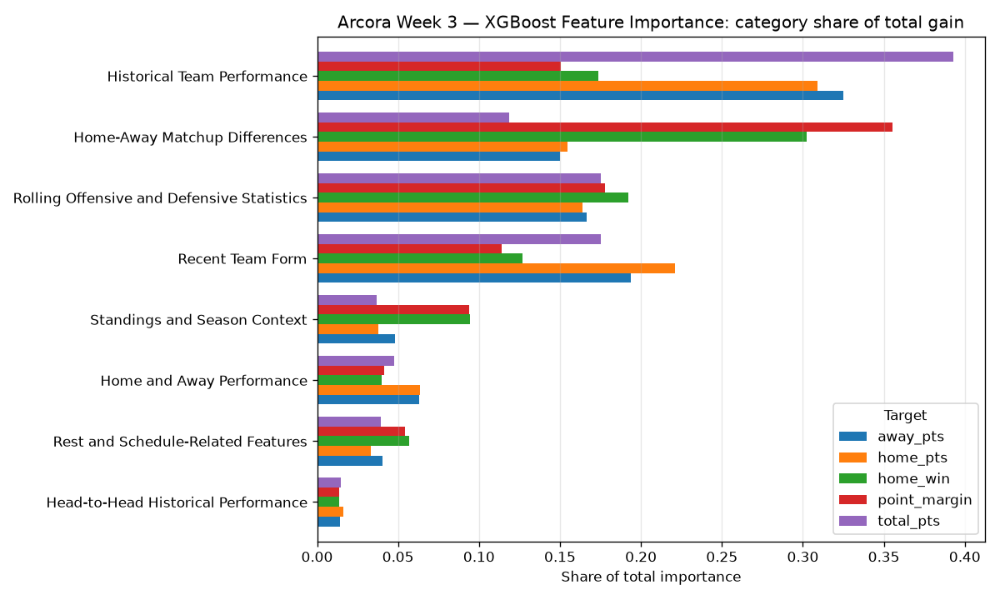

# Arcora Week 3 — XGBoost Feature Importance

> **Exploratory analysis.** Importance shows what the fitted models rely on; it is not evidence of causation. Many features are strongly correlated (home, away, and difference variants), so importance is shared across related columns.

- **Total gain** is computed from the training fit and normalized to sum to 1 per model.
- **Grouped permutation importance** permutes every feature in a category together on the validation split and reports the mean increase in the primary metric (MAE for regression, log loss for classification) over repeated shuffles.

## Category share of native importance

| Category | `away_pts` | `home_pts` | `home_win` | `point_margin` | `total_pts` |
| :--- | ---: | ---: | ---: | ---: | ---: |
| Historical Team Performance | 0.325 | 0.309 | 0.174 | 0.150 | 0.393 |
| Home-Away Matchup Differences | 0.150 | 0.155 | 0.302 | 0.355 | 0.119 |
| Rolling Offensive and Defensive Statistics | 0.167 | 0.164 | 0.192 | 0.178 | 0.175 |
| Recent Team Form | 0.194 | 0.221 | 0.127 | 0.114 | 0.175 |
| Standings and Season Context | 0.048 | 0.038 | 0.095 | 0.094 | 0.037 |
| Home and Away Performance | 0.063 | 0.064 | 0.040 | 0.042 | 0.048 |
| Rest and Schedule-Related Features | 0.040 | 0.033 | 0.057 | 0.054 | 0.039 |
| Head-to-Head Historical Performance | 0.014 | 0.016 | 0.014 | 0.013 | 0.014 |

## Grouped permutation importance (validation)

| Model | Category | Features | Metric | Mean increase | Std |
| :--- | :--- | ---: | :--- | ---: | ---: |
| `xgboost_regressor__home_pts` | Recent Team Form | 40 | mae | +0.1762 | 0.0409 |
| `xgboost_regressor__home_pts` | Home-Away Matchup Differences | 50 | mae | +0.1070 | 0.0269 |
| `xgboost_regressor__home_pts` | Historical Team Performance | 48 | mae | +0.0591 | 0.0266 |
| `xgboost_regressor__home_pts` | Rolling Offensive and Defensive Statistics | 56 | mae | +0.0306 | 0.0105 |
| `xgboost_regressor__home_pts` | Home and Away Performance | 10 | mae | +0.0210 | 0.0202 |
| `xgboost_regressor__home_pts` | Standings and Season Context | 14 | mae | +0.0174 | 0.0111 |
| `xgboost_regressor__home_pts` | Rest and Schedule-Related Features | 20 | mae | +0.0048 | 0.0040 |
| `xgboost_regressor__home_pts` | Head-to-Head Historical Performance | 4 | mae | -0.0008 | 0.0087 |
| `xgboost_regressor__away_pts` | Recent Team Form | 40 | mae | +0.1605 | 0.0456 |
| `xgboost_regressor__away_pts` | Historical Team Performance | 48 | mae | +0.1379 | 0.0509 |
| `xgboost_regressor__away_pts` | Home-Away Matchup Differences | 50 | mae | +0.0923 | 0.0160 |
| `xgboost_regressor__away_pts` | Rolling Offensive and Defensive Statistics | 56 | mae | +0.0417 | 0.0157 |
| `xgboost_regressor__away_pts` | Standings and Season Context | 14 | mae | +0.0402 | 0.0050 |
| `xgboost_regressor__away_pts` | Rest and Schedule-Related Features | 20 | mae | +0.0342 | 0.0077 |
| `xgboost_regressor__away_pts` | Head-to-Head Historical Performance | 4 | mae | +0.0086 | 0.0127 |
| `xgboost_regressor__away_pts` | Home and Away Performance | 10 | mae | -0.0101 | 0.0051 |
| `xgboost_regressor__total_pts` | Recent Team Form | 40 | mae | +0.3127 | 0.0677 |
| `xgboost_regressor__total_pts` | Historical Team Performance | 48 | mae | +0.1675 | 0.0705 |
| `xgboost_regressor__total_pts` | Rolling Offensive and Defensive Statistics | 56 | mae | +0.0796 | 0.0186 |
| `xgboost_regressor__total_pts` | Standings and Season Context | 14 | mae | +0.0350 | 0.0092 |
| `xgboost_regressor__total_pts` | Home-Away Matchup Differences | 50 | mae | +0.0212 | 0.0049 |
| `xgboost_regressor__total_pts` | Home and Away Performance | 10 | mae | +0.0154 | 0.0072 |
| `xgboost_regressor__total_pts` | Head-to-Head Historical Performance | 4 | mae | +0.0148 | 0.0152 |
| `xgboost_regressor__total_pts` | Rest and Schedule-Related Features | 20 | mae | -0.0030 | 0.0027 |
| `xgboost_regressor__point_margin` | Home-Away Matchup Differences | 50 | mae | +1.0059 | 0.0688 |
| `xgboost_regressor__point_margin` | Standings and Season Context | 14 | mae | +0.0438 | 0.0074 |
| `xgboost_regressor__point_margin` | Rest and Schedule-Related Features | 20 | mae | +0.0374 | 0.0059 |
| `xgboost_regressor__point_margin` | Recent Team Form | 40 | mae | +0.0180 | 0.0088 |
| `xgboost_regressor__point_margin` | Home and Away Performance | 10 | mae | +0.0145 | 0.0098 |
| `xgboost_regressor__point_margin` | Head-to-Head Historical Performance | 4 | mae | +0.0059 | 0.0056 |
| `xgboost_regressor__point_margin` | Historical Team Performance | 48 | mae | -0.0028 | 0.0107 |
| `xgboost_regressor__point_margin` | Rolling Offensive and Defensive Statistics | 56 | mae | -0.0041 | 0.0047 |
| `xgboost_classifier__home_win` | Home-Away Matchup Differences | 50 | log_loss | +0.0537 | 0.0043 |
| `xgboost_classifier__home_win` | Standings and Season Context | 14 | log_loss | +0.0039 | 0.0009 |
| `xgboost_classifier__home_win` | Rest and Schedule-Related Features | 20 | log_loss | +0.0029 | 0.0004 |
| `xgboost_classifier__home_win` | Recent Team Form | 40 | log_loss | +0.0012 | 0.0005 |
| `xgboost_classifier__home_win` | Head-to-Head Historical Performance | 4 | log_loss | +0.0008 | 0.0004 |
| `xgboost_classifier__home_win` | Home and Away Performance | 10 | log_loss | +0.0005 | 0.0002 |
| `xgboost_classifier__home_win` | Rolling Offensive and Defensive Statistics | 56 | log_loss | -0.0002 | 0.0007 |
| `xgboost_classifier__home_win` | Historical Team Performance | 48 | log_loss | -0.0005 | 0.0006 |

## Top 15 features — `xgboost_regressor__point_margin`

| Rank | Feature | Category | Importance |
| ---: | :--- | :--- | ---: |
| 1 | `hist_win_pct_diff` | Home-Away Matchup Differences | 0.0674 |
| 2 | `hist_margin_avg_diff` | Home-Away Matchup Differences | 0.0641 |
| 3 | `standings_win_pct_diff` | Standings and Season Context | 0.0419 |
| 4 | `hist_net_rtg_diff` | Home-Away Matchup Differences | 0.0411 |
| 5 | `venue_margin_avg_diff` | Home-Away Matchup Differences | 0.0147 |
| 6 | `home_standings_games_played` | Standings and Season Context | 0.0079 |
| 7 | `rolling_margin_avg_10_diff` | Home-Away Matchup Differences | 0.0076 |
| 8 | `home_venue_games_played` | Home and Away Performance | 0.0072 |
| 9 | `venue_win_pct_diff` | Home-Away Matchup Differences | 0.0067 |
| 10 | `home_standings_wins` | Standings and Season Context | 0.0063 |
| 11 | `rolling_net_rtg_10_diff` | Home-Away Matchup Differences | 0.0061 |
| 12 | `away_standings_games_played` | Standings and Season Context | 0.0059 |
| 13 | `home_venue_margin_avg` | Home and Away Performance | 0.0058 |
| 14 | `away_standings_wins` | Standings and Season Context | 0.0054 |
| 15 | `home_rolling_margin_avg_5` | Recent Team Form | 0.0054 |

## Top 15 features — `xgboost_classifier__home_win`

| Rank | Feature | Category | Importance |
| ---: | :--- | :--- | ---: |
| 1 | `hist_margin_avg_diff` | Home-Away Matchup Differences | 0.0502 |
| 2 | `standings_win_pct_diff` | Standings and Season Context | 0.0484 |
| 3 | `hist_win_pct_diff` | Home-Away Matchup Differences | 0.0415 |
| 4 | `hist_net_rtg_diff` | Home-Away Matchup Differences | 0.0350 |
| 5 | `venue_margin_avg_diff` | Home-Away Matchup Differences | 0.0099 |
| 6 | `away_hist_insufficient_history` | Historical Team Performance | 0.0081 |
| 7 | `rolling_margin_avg_5_diff` | Home-Away Matchup Differences | 0.0072 |
| 8 | `rolling_net_rtg_10_diff` | Home-Away Matchup Differences | 0.0064 |
| 9 | `venue_win_pct_diff` | Home-Away Matchup Differences | 0.0061 |
| 10 | `away_standings_games_played` | Standings and Season Context | 0.0061 |
| 11 | `home_venue_games_played` | Home and Away Performance | 0.0058 |
| 12 | `away_rolling_win_pct_5` | Recent Team Form | 0.0058 |
| 13 | `home_hist_net_rtg` | Historical Team Performance | 0.0057 |
| 14 | `home_hist_games_played` | Historical Team Performance | 0.0056 |
| 15 | `away_standings_wins` | Standings and Season Context | 0.0055 |
