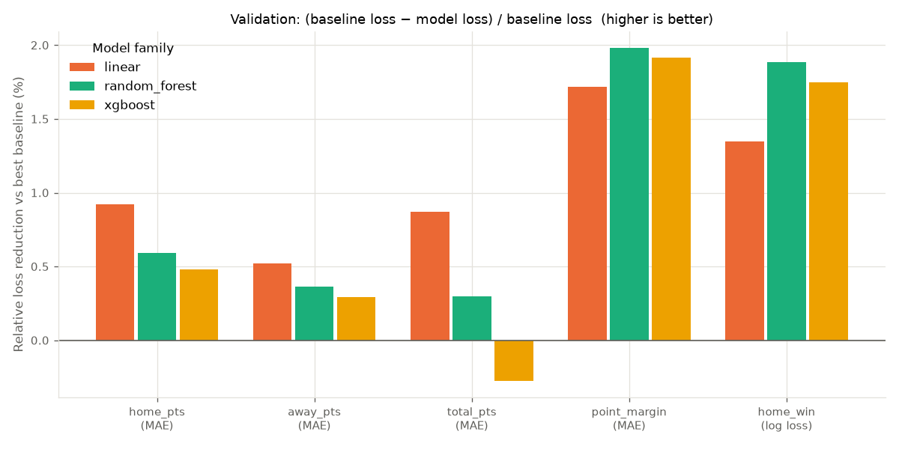
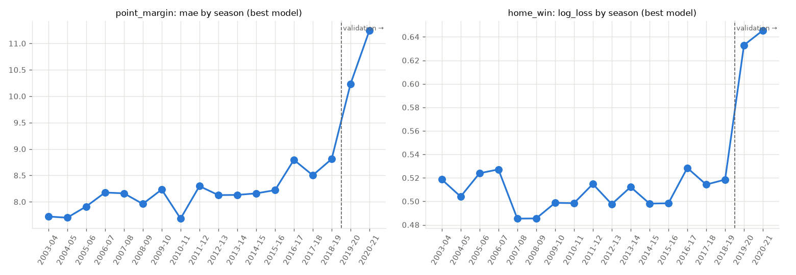

# Arcora Week 3 — Baseline Modeling Report

This report documents Arcora's first NBA game prediction models: naive baselines, linear and logistic regression, Random Forest, and XGBoost, trained and compared under one chronological protocol. It is generated by the unified modeling pipeline:

```bash
python scripts/train_models.py
```

- **Run**: 2026-11-24T10:03:27+00:00 → 2026-11-24T10:05:19+00:00 (112s, mode `train`)
- **Models evaluated**: 38 across 4 families and 5 targets
- **Overall status**: PASSED (leakage, split, artifact, and reproducibility checks)

---

## 1. Dataset and Feature Summary

- **Source**: `data/features/nba_game_features.parquet` — 24,848 eligible non-preseason games (Regular Season, Play-In, Playoffs), 2003-04 to 2022-23 (partial).
- **Model inputs**: 242 approved pregame features, including 8 missing-value indicators. Metadata (8 columns), identifiers, targets, and post-game columns are excluded.
- **Targets**: `home_pts`, `away_pts`, `total_pts`, `point_margin`, `home_win` (four regression targets, one binary classification target).
- **Dataset fingerprint**: `eebe4ed42461191c0073cf1817916da55887a0ebab333dbf84781bed2c1d8ff6`

| Feature category | Features |
| :--- | ---: |
| Rolling Offensive and Defensive Statistics | 56 |
| Home-Away Matchup Differences | 50 |
| Historical Team Performance | 48 |
| Recent Team Form | 40 |
| Rest and Schedule-Related Features | 20 |
| Standings and Season Context | 14 |
| Home and Away Performance | 10 |
| Head-to-Head Historical Performance | 4 |

## 2. Chronological Splits

| Split | Seasons | Games | Dates | Role |
| :--- | :--- | ---: | :--- | :--- |
| `train` | 2003-04 to 2018-19 | 20,734 | 2003-10-28 → 2019-06-13 | Model fitting |
| `validation` | 2019-20 to 2020-21 | 2,314 | 2019-10-22 → 2021-07-20 | Model comparison, early stopping, and hyperparameter selection |
| `test` | 2021-22 | 1,323 | 2021-10-19 → 2022-06-16 | Primary locked evaluation |
| `holdout` | 2022-23 | 477 | 2022-10-18 → 2022-12-22 | Secondary out-of-time partial-season holdout |

Split sizes differ from the illustrative figures in the Week 2 report (20,762 / 2,282 / 1,327); the season definitions are unchanged and the counts above are computed from the dataset. The cause is documented in [`docs/modeling_strategy.md`](../docs/modeling_strategy.md#split-count-reconciliation-week-2-plan-vs-dataset).

Split integrity checks: **7/7 passed** (no game in multiple splits, strict date ordering, same-day games never cross a boundary, partial 2022-23 season isolated). Full definitions: [`docs/modeling_strategy.md`](../docs/modeling_strategy.md).

## 3. Models Implemented

| Family | Module | Description |
| :--- | :--- | :--- |
| Naive baselines (`baseline`) | `src/arcora/models/baselines.py` | Mean / median `DummyRegressor`, most-frequent / prior `DummyClassifier`, and a team-strength historical reference with league-level fallbacks. |
| Linear & logistic regression (`linear`) | `src/arcora/models/linear_models.py` | OLS, Ridge, Lasso, and L2 logistic regression in median-imputation + scaling pipelines; penalties chosen on validation. |
| Random Forest (`random_forest`) | `src/arcora/models/random_forest.py` | 300 trees, depth 14, 25-game leaves, median imputation; fixed configuration. |
| XGBoost (`xgboost`) | `src/arcora/models/xgboost_models.py` | Histogram gradient boosting, depth 4, learning rate 0.03, native missing values, early stopping on validation. |

Details and hyperparameters: [`docs/model_families.md`](../docs/model_families.md).

## 4. Evaluation Methodology

- Every model is fitted on the training split only; imputers, scalers, and baseline statistics included.
- Model selection (Ridge/Lasso penalties, logistic `C`, XGBoost early stopping) uses the validation split only, so tuned models' validation scores are mildly optimistic.
- Primary metrics: **MAE** for regression and **log loss** for `home_win`; RMSE, R², accuracy, balanced accuracy, precision, recall, ROC-AUC, and Brier score are also reported. All metrics come from one implementation (`src/arcora/evaluation/metrics.py`).
- **Reading the baseline comparisons.** *Δ vs best baseline* is the absolute difference `model − baseline` in the metric's own units (points of MAE, or nats of log loss); negative is better. *Relative loss reduction* is `(baseline − model) / baseline × 100`, where the denominator is the best baseline's MAE or log loss on validation; positive is better. It is a percentage reduction in loss, not a gain in accuracy points. The best baseline is the lowest-loss baseline per target, which is always a non-degenerate model; `most_frequent_baseline` (0/1 probabilities) can never be the probability benchmark.
- Comparisons are refused unless every result shares the same dataset, split, and feature fingerprints. A paired bootstrap over validation games tests whether the best model's improvement over the best baseline is meaningful.

## 5. Regression Model Comparison (validation)

### `home_pts`

| Rank | Model | Family | MAE | RMSE | R² | Δ MAE vs best baseline | MAE reduction |
| ---: | :--- | :--- | ---: | ---: | ---: | ---: | ---: |
| 1 | `ridge_regression` | linear | 9.447 | 11.965 | 0.0922 | -0.0878 | +0.92% |
| 2 | `lasso_regression` | linear | 9.459 | 11.980 | 0.0900 | -0.0755 | +0.79% |
| 3 | `linear_regression` | linear | 9.470 | 11.995 | 0.0876 | -0.0649 | +0.68% |
| 4 | `random_forest_regressor` | random_forest | 9.478 | 12.010 | 0.0854 | -0.0565 | +0.59% |
| 5 | `xgboost_regressor` | xgboost | 9.489 | 12.016 | 0.0845 | -0.0459 | +0.48% |
| 6 | `historical_reference` | baseline | 9.535 | 12.067 | 0.0766 | -0.0000 | +0.00% |
| 7 | `median_baseline` | baseline | 13.232 | 16.443 | -0.7144 | +3.6974 | -38.78% |
| 8 | `mean_baseline` | baseline | 13.298 | 16.510 | -0.7285 | +3.7631 | -39.47% |

### `away_pts`

| Rank | Model | Family | MAE | RMSE | R² | Δ MAE vs best baseline | MAE reduction |
| ---: | :--- | :--- | ---: | ---: | ---: | ---: | ---: |
| 1 | `lasso_regression` | linear | 9.379 | 11.744 | 0.1010 | -0.0494 | +0.52% |
| 2 | `ridge_regression` | linear | 9.383 | 11.756 | 0.0991 | -0.0454 | +0.48% |
| 3 | `random_forest_regressor` | random_forest | 9.394 | 11.814 | 0.0902 | -0.0345 | +0.37% |
| 4 | `xgboost_regressor` | xgboost | 9.401 | 11.842 | 0.0860 | -0.0277 | +0.29% |
| 5 | `historical_reference` | baseline | 9.429 | 11.887 | 0.0789 | -0.0000 | +0.00% |
| 6 | `linear_regression` | linear | 9.446 | 11.844 | 0.0856 | +0.0172 | -0.18% |
| 7 | `mean_baseline` | baseline | 14.238 | 17.372 | -0.9671 | +4.8090 | -51.00% |
| 8 | `median_baseline` | baseline | 14.809 | 17.961 | -1.1027 | +5.3807 | -57.07% |

### `total_pts`

| Rank | Model | Family | MAE | RMSE | R² | Δ MAE vs best baseline | MAE reduction |
| ---: | :--- | :--- | ---: | ---: | ---: | ---: | ---: |
| 1 | `ridge_regression` | linear | 15.237 | 19.342 | 0.0823 | -0.1341 | +0.87% |
| 2 | `lasso_regression` | linear | 15.281 | 19.387 | 0.0781 | -0.0904 | +0.59% |
| 3 | `random_forest_regressor` | random_forest | 15.325 | 19.475 | 0.0697 | -0.0459 | +0.30% |
| 4 | `historical_reference` | baseline | 15.371 | 19.512 | 0.0662 | -0.0000 | +0.00% |
| 5 | `xgboost_regressor` | xgboost | 15.413 | 19.565 | 0.0611 | +0.0419 | -0.27% |
| 6 | `linear_regression` | linear | 15.434 | 19.519 | 0.0654 | +0.0632 | -0.41% |
| 7 | `mean_baseline` | baseline | 25.213 | 30.530 | -1.2862 | +9.8423 | -64.03% |
| 8 | `median_baseline` | baseline | 25.756 | 31.074 | -1.3685 | +10.3853 | -67.56% |

### `point_margin`

| Rank | Model | Family | MAE | RMSE | R² | Δ MAE vs best baseline | MAE reduction |
| ---: | :--- | :--- | ---: | ---: | ---: | ---: | ---: |
| 1 | `random_forest_regressor` | random_forest | 10.748 | 13.631 | 0.1339 | -0.2172 | +1.98% |
| 2 | `xgboost_regressor` | xgboost | 10.755 | 13.649 | 0.1317 | -0.2100 | +1.92% |
| 3 | `lasso_regression` | linear | 10.777 | 13.670 | 0.1290 | -0.1885 | +1.72% |
| 4 | `ridge_regression` | linear | 10.818 | 13.681 | 0.1275 | -0.1471 | +1.34% |
| 5 | `linear_regression` | linear | 10.837 | 13.686 | 0.1269 | -0.1286 | +1.17% |
| 6 | `historical_reference` | baseline | 10.965 | 13.898 | 0.0997 | -0.0000 | +0.00% |
| 7 | `mean_baseline` | baseline | 11.679 | 14.720 | -0.0100 | +0.7139 | -6.51% |
| 8 | `median_baseline` | baseline | 11.732 | 14.841 | -0.0267 | +0.7670 | -6.99% |

## 6. Classification Model Comparison — `home_win` (validation)

| Rank | Model | Family | Log loss | Brier | ROC-AUC | Accuracy | Balanced acc. | Δ log loss vs best baseline | Log-loss reduction |
| ---: | :--- | :--- | ---: | ---: | ---: | ---: | ---: | ---: | ---: |
| 1 | `random_forest_classifier` | random_forest | 0.6393 | 0.2242 | 0.6824 | 0.6340 | 0.6163 | -0.0123 | +1.89% |
| 2 | `xgboost_classifier` | xgboost | 0.6402 | 0.2243 | 0.6824 | 0.6396 | 0.6255 | -0.0114 | +1.75% |
| 3 | `logistic_regression` | linear | 0.6428 | 0.2255 | 0.6787 | 0.6283 | 0.6136 | -0.0088 | +1.35% |
| 4 | `historical_reference` | baseline | 0.6516 | 0.2297 | 0.6744 | 0.6175 | 0.5902 | -0.0000 | +0.00% |
| 5 | `prior_baseline` | baseline | 0.6943 | 0.2505 | 0.5000 | 0.5467 | 0.5000 | +0.0426 | -6.54% |
| 6 | `most_frequent_baseline` | baseline | 15.6577 | 0.4533 | 0.5000 | 0.5467 | 0.5000 | +15.0061 | -2302.87% |

## 7. Best-Performing Model per Task

| Target | Best model | Family | Validation score | Best baseline | Absolute Δ | Relative loss reduction | Bootstrap 95% CI (Δ loss) | Significant |
| :--- | :--- | :--- | ---: | ---: | ---: | ---: | :--- | :---: |
| `home_pts` | `ridge_regression` | linear | 9.4469 mae | 9.5347 | -0.0878 | +0.92% | [-0.1514, -0.0208] | Yes |
| `away_pts` | `lasso_regression` | linear | 9.3794 mae | 9.4288 | -0.0494 | +0.52% | [-0.1280, +0.0250] | No |
| `total_pts` | `ridge_regression` | linear | 15.2369 mae | 15.3710 | -0.1341 | +0.87% | [-0.2462, -0.0213] | Yes |
| `point_margin` | `random_forest_regressor` | random_forest | 10.7479 mae | 10.9651 | -0.2172 | +1.98% | [-0.3166, -0.1158] | Yes |
| `home_win` | `random_forest_classifier` | random_forest | 0.6393 log_loss | 0.6516 | -0.0123 | +1.89% | [-0.0187, -0.0057] | Yes |

Best model of each family (primary metric, validation):

| Target | `baseline` | `linear` | `random_forest` | `xgboost` |
| :--- | ---: | ---: | ---: | ---: |
| `home_pts` | 9.5347 | 9.4469 | 9.4782 | 9.4889 |
| `away_pts` | 9.4288 | 9.3794 | 9.3942 | 9.4011 |
| `total_pts` | 15.3710 | 15.2369 | 15.3250 | 15.4129 |
| `point_margin` | 10.9651 | 10.7766 | 10.7479 | 10.7550 |
| `home_win` | 0.6516 | 0.6428 | 0.6393 | 0.6402 |

## 8. Baseline Comparisons

| Target | Baseline | Validation score | Training score |
| :--- | :--- | ---: | ---: |
| `away_pts` | `historical_reference` | 9.4288 mae | 8.8523 |
| `away_pts` | `mean_baseline` | 14.2378 mae | 10.1405 |
| `away_pts` | `median_baseline` | 14.8094 mae | 10.1382 |
| `home_pts` | `historical_reference` | 9.5347 mae | 8.8345 |
| `home_pts` | `median_baseline` | 13.2321 mae | 10.1008 |
| `home_pts` | `mean_baseline` | 13.2978 mae | 10.1012 |
| `home_win` | `historical_reference` | 0.6516 log_loss | 0.6245 |
| `home_win` | `prior_baseline` | 0.6943 log_loss | 0.6737 |
| `home_win` | `most_frequent_baseline` | 15.6577 log_loss | 13.8765 |
| `point_margin` | `historical_reference` | 10.9651 mae | 9.7550 |
| `point_margin` | `mean_baseline` | 11.6790 mae | 10.5397 |
| `point_margin` | `median_baseline` | 11.7321 mae | 10.5074 |
| `total_pts` | `historical_reference` | 15.3710 mae | 14.6745 |
| `total_pts` | `mean_baseline` | 25.2133 mae | 17.2678 |
| `total_pts` | `median_baseline` | 25.7563 mae | 17.2463 |

- Constant (mean/median) baselines are anchored to the 2003-19 scoring level; league scoring rose in 2019-21, so their validation R² is negative (as low as -1.286).
- The **historical reference** (season-to-date team averages plus a home-court offset) is the strongest baseline for 5 of 5 targets.
- `most_frequent_baseline` outputs degenerate 0/1 probabilities, so its log loss is very large by construction; `prior_baseline` is the meaningful probability baseline.

## 9. Error Analysis

Full breakdowns (by season, home team, away team, game type; largest errors; confusion matrix; calibration): [`model_evaluation_report.md`](model_evaluation_report.md).



| Target (best model) | Bias (mean residual) | Residual std | Within ±5 | Within ±10 |
| :--- | ---: | ---: | ---: | ---: |
| `home_pts` | +0.54 | 11.96 | 33.7% | 61.1% |
| `away_pts` | -0.05 | 11.75 | 32.8% | 61.4% |
| `total_pts` | +0.24 | 19.34 | 20.2% | 40.6% |
| `point_margin` | +0.93 | 13.60 | 29.6% | 54.8% |

`home_win` confusion (best model, validation): TP 1019, FP 601, TN 448, FN 246.



Key observations:

- Errors jump at the validation boundary. Part of this is ordinary out-of-sample error, but 2019-20 and 2020-21 were also atypical: a shortened season with bubble playoffs, then a season with limited crowds. Home advantage and scoring levels shifted away from the training era.
- Score-level targets (`home_pts`, `away_pts`, `total_pts`) are dominated by the scoring-environment level; models improve only modestly on the historical reference. Relative targets (`point_margin`, `home_win`) benefit most from the matchup features.
- Classifiers over-predict home wins in validation (more false positives than false negatives) because the training-era home-win rate is higher than in 2019-21.
- Grouped permutation importance (Random Forest, `home_win`): Home-Away Matchup Differences (+0.0343 log_loss), Standings and Season Context (+0.0026 log_loss), Historical Team Performance (+0.0025 log_loss). Importance is exploratory, not causal.

## 10. Quality and Reproducibility Checks

| Check | Result |
| :--- | :--- |
| Week 2 leakage audit (LEAK-001–LEAK-007) | 7/7 passed |
| Chronological split checks (SPLIT-001–SPLIT-007) | 7/7 passed |
| Artifact reload, feature order, prediction shape, valid probabilities, missing values, column-order invariance, match with cached predictions | 38/38 artifacts passed |
| Repeated training with identical configuration | 6/6 identical (max |Δ| = 2.22e-16) |
| Test suite, Ruff, Mypy | `pytest`, `ruff check src tests scripts`, `mypy src` |

## 11. Locked Evaluation Status

The primary 2021-22 test split and the partial 2022-23 holdout were **not evaluated**. All model selection in this report used validation data only; both locked splits remain available for an unbiased final assessment.

## 12. Limitations

- **Distribution shift**: the validation seasons are unusual (COVID-shortened season, bubble playoffs, limited crowds), so validation rankings may not transfer fully to normal seasons.
- **Optimistic tuned scores**: penalties and boosting rounds were selected on validation; differences between top models are often within bootstrap noise.
- **No player-level availability**: injuries, rest decisions, and lineup changes are not represented, which caps achievable accuracy for single games.
- **Era-level features**: absolute scoring features carry the training era's scoring level; there is no explicit league-environment or recency weighting.
- **Independent targets**: home, away, total, and margin models are trained separately, so their predictions are not guaranteed to form a consistent scoreline.
- **Limited tuning**: Random Forest and XGBoost use single baseline configurations.

## 13. Recommended Candidates for Week 4

1. **XGBoost and Random Forest for `point_margin` and `home_win`** — the strongest relative-outcome models; tune them with chronological (rolling-origin) validation.
2. **Regularized linear models for score-level targets** — Ridge/Lasso currently lead `home_pts`, `away_pts`, and `total_pts`; keep them as strong, interpretable references.
3. **Probability calibration** — fit Platt or isotonic calibration on validation predictions for the `home_win` classifiers and track Brier score / reliability.
4. **Drift-aware features** — add league-average-to-date scoring, season-relative (z-scored) team metrics, and recency-weighted training to reduce era bias.
5. **Consistent scoreline modeling** — predict `point_margin` and `total_pts` jointly and derive home/away scores, or use multi-output models.
6. **Final locked evaluation** — after Week 4 selection, evaluate the chosen models once on the 2021-22 test split and report the partial 2022-23 holdout separately.
